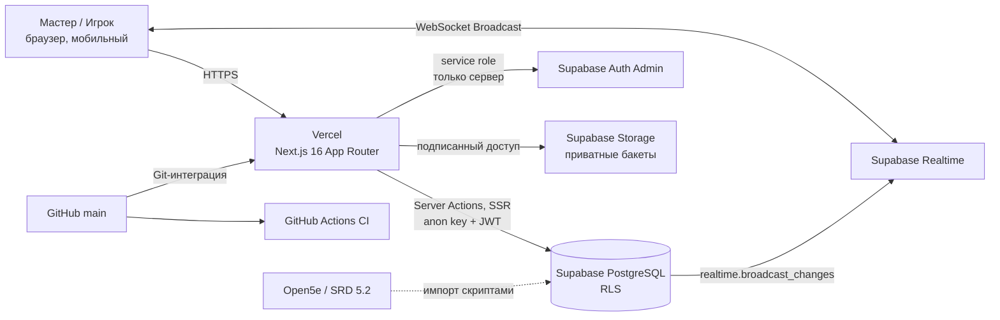
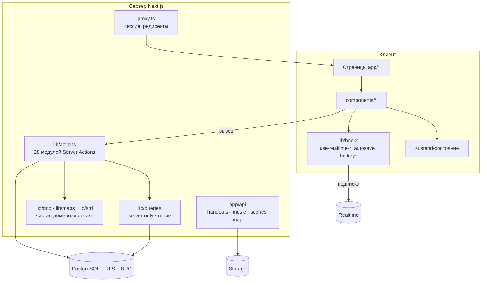
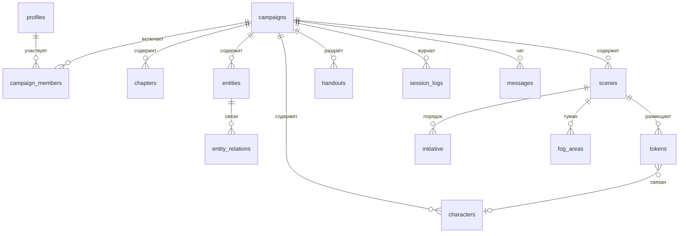
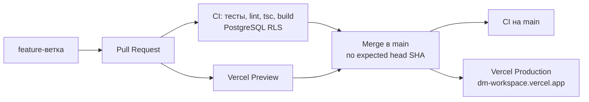

# Архитектура DM Workspace

Актуальность: 2026-11-07 · main `7e4fbeb`

## 1. Контекст системы

## 2. Слои приложения

Принципы:

- **Запись только через Server Actions** (`src/lib/actions`). Каждое действие проверяет членство/роль, whitelist полей и результат запроса.
- **Доменная логика чистая** (`src/lib/dnd`, `src/lib/maps`) — без I/O, покрыта unit-тестами `node --test`.
- **RLS — последняя линия защиты.** Проверки в коде не заменяют политики; подзапросы к RLS-таблицам — только через `security definer` функции (`is_campaign_dm`, `user_campaign_ids`).
- **Конкурентность:** JSON персонажа пишется через CAS (сравнение снимка), класс/подкласс — атомарным RPC.

## 3. Маршруты

| Зона | Маршруты | Доступ |
| --- | --- | --- |
| Публичная | `/`, `/login`, `/signup`, `/srd-license`, `/join/[code]` | все (redirect для авторизованных) |
| Кабинет | `/dashboard`, `/settings` | авторизованные |
| Кампания | `/campaign/[id]` + `chapters`, `entities`, `characters`, `scenes`, `session`, `sessions`, `bestiary`, `spells`, `items`, `generators` | участники; редактирование — ГМ |
| API | `/api/handouts/[id]/image`, `/api/music/tracks/[id]/audio`, `/api/scenes/[id]/map` | выдача приватных файлов после проверки доступа |

## 4. Данные

Миграции: `supabase/migrations` (15 файлов, с 2026-10-25). Базовая схема создана ранее через Dashboard и в Git отсутствует — технический долг TD-01.

## 5. Realtime

Broadcast-каналы (не `postgres_changes`) для: tokens, initiative, fog, walls, summons, token owners, messages, handouts, music, chapters. Триггеры вызывают `realtime.broadcast_changes()`; авторизация каналов — миграция `20261027000100`. При переподключении клиент сверяет снимок (initiative/tokens), устаревшие ответы отбрасываются.

## 6. Поставка

Наряду с Vercel на каждый push в main срабатывает встроенный workflow «pages build and deployment» (GitHub Pages). Он не обслуживает приложение — см. TD-07.

## 7. Тестовый контур

| Набор | Команда | В CI |
| --- | --- | --- |
| Безопасность миграций (статика) | `test:security:pr37` | да |
| PostgreSQL RLS/Storage/Realtime | job `postgres-security` | да |
| HP-харнесс (mock) | `test:hp:harness` | да |
| Персонажи, HP, level-up | `test:characters` | да |
| Карты и бой | `test:maps` | да |
| Каталоги | magic-item, item-filters, spell-bestiary | да |
| Офлайн UI кампании (Playwright) | `test:campaign-ui` | да |
| Production CSS layout | `test:production-layout` | да |
| Лендинг и демо | `test:public-landing` | да |
| HP baseline PostgreSQL | workflow `hp-local-postgres` | при изменении `tests/hp-postgres` |
| Smoke E2E с авторизацией | `test:e2e:smoke` | **нет** (нужен Supabase) |
| Visual regression | `test:e2e:screenshots` | **нет** |
| Lighthouse | `lighthouserc.json` | **нет** |
