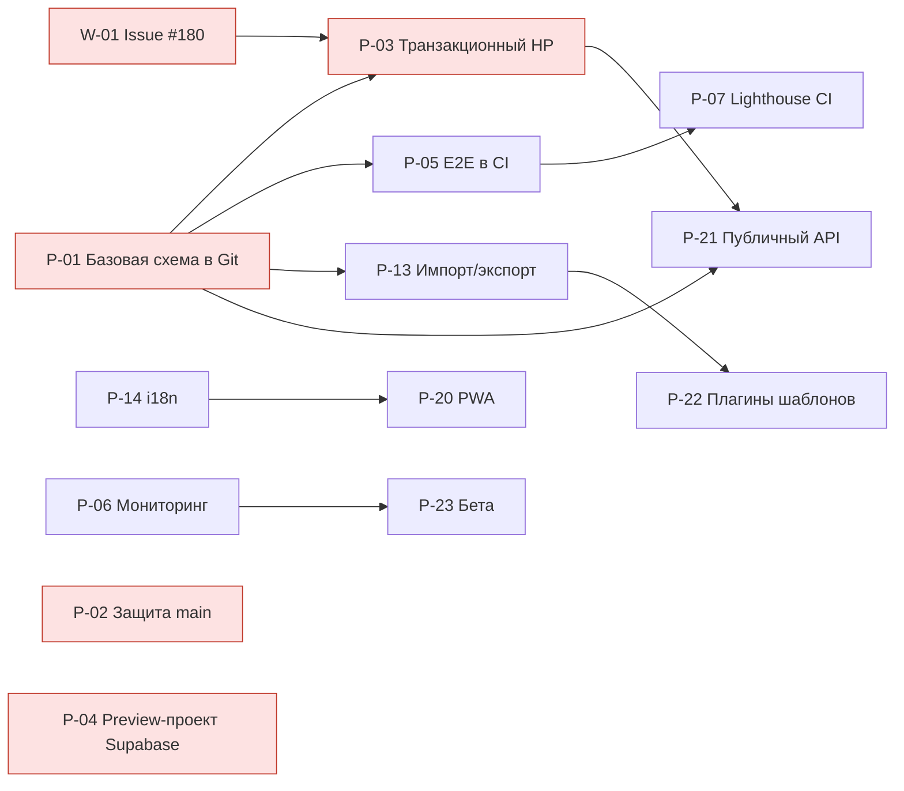

# Дорожная карта DM Workspace

Актуальность: 2026-11-07 · main `df690f1` (PR #274) · Production: Vercel READY, HTTP 200

Доска планирования: [Miro](https://miro.com/app/board/uXjVH5lNlG4=/) (разделы «Сводка проекта», «Выполнено», «В работе», «Запланировано», «Архитектура», «Конвейер поставки», «Зависимости и приоритеты», «Технический долг»).

Документ — единый источник планирования. Доска Miro отражает этот файл; при расхождении верен GitHub.
Статусы: ✅ выполнено · 🔄 в работе · 📋 запланировано · ⛔ заблокировано.
Приоритеты: **P0** — риск данных/безопасности, **P1** — ключевая ценность продукта, **P2** — улучшение, **P3** — по возможности.

## 1. Сводка

| Показатель | Значение |
| --- | --- |
| Влитых PR | 127 (144 закрыты без слияния, ветки сохранены) |
| Открытых PR | 0 |
| Открытых Issues | 3 (#180, #207, #209) |
| Миграций Supabase в репозитории | 15 (только hardening; базовая схема вне Git — см. TD-01) |
| Исходный код / тесты | ~44 600 / ~10 900 строк TypeScript |
| CI на main | зелёный (`Lint, typecheck, and build`, PostgreSQL RLS) |

## 2. Выполнено

| Эпик | Содержание | PR | Период |
| --- | --- | --- | --- |
| E0. Фундамент | Кампании, роли ГМ/игрок, приглашения, главы, сущности, RLS, VTT, мультимедиа, SRD | до #1 | 15–18.10 |
| E1. Качество кода | ESLint 0 ошибок, Prettier, Husky, Playwright smoke + visual regression, CI | #5, #6 | 20–25.10 |
| E2. Безопасность server actions | Whitelist обновлений, scope к кампании/сцене, валидация ввода, удаление аккаунта через Auth Admin | #7–#30 | 25.10 |
| E3. Безопасность БД и Storage | Авторизация Realtime Broadcast, приватные Storage-бакеты, отзыв anon-мутаций, guard invite-code, RSVP/entity RPC, default grants, целостность связей | #37, #218–#225 | 27–28.10 |
| E4. Целостность данных персонажа | Атомарный RPC класса/подкласса, CAS для всех JSON-записей, валидация HP и level-up, legacy-HP рендер | #206–#217, #242, #246–#249 | 28–29.10 |
| E5. Доказательная база HP | Офлайн-харнесс, изолированный PostgreSQL baseline (42 теста), аудит writer-путей | #173–#181, #234–#241 | 27–29.10 |
| E6. UX и мобильная версия | Навигация кампании, карточки, safe-area, touch-цели, вкладки персонажа, локализация | #146, #183–#205, #226, #231, #243–#245 | 27–29.10 |
| E7. Каталоги SRD 5.2 | Магические предметы, поиск, фильтры, карточки заклинаний/бестиария | #250–#257 | 30–31.10 |
| E8. Сессии | Карточки сессий, RSVP, хаб планирования, экспорт календаря | #258, #259, #273 | 31.10–07.11 |
| E9. Тактическая карта | Новая рабочая область карты, загрузка карт, таймлайн инициативы, поиск участников, области заклинаний, маршруты | #261–#269 | 05–07.11 |
| E10. Публичный вход | Лендинг, офлайн-демо стола, онбординг приглашений | #270–#272 | 07.11 |
| E11. Гигиена бэклога | 84 устаревших PR архивированы без слияния, требования сохранены в бэклоге B01–B0x | #241 | 28.10 |
| E12. Управление разработкой | Дорожная карта, архитектура, регламент релиза, реестр техдолга, доска Miro | #274 | 07.11 |
| E13. Кубики в чате | Формулы, преимущество/помеха d20, редактируемый ввод и ошибки отправки в обоих чатах; [спецификация](CHAT_DICE_WORKBENCH.md) | #276 | 09.11 |
| E14. Мастерская ведущего | Карточки пяти генераторов, сохранение результатов при переключении, доступное копирование и ошибки; [спецификация](GM_GENERATOR_WORKBENCH.md) | #277 | 12.11 |

## 3. В работе

| ID | Задача | Приоритет | Состояние | Зависимости |
| --- | --- | --- | --- | --- |
| W-01 | Атомарная координация HP всех writer-путей (Issue #180, бэклог B05) | P0 | ⛔ Дефекты воспроизведены в локальном PostgreSQL; установленный RPC не исправлен | Контракт `HP_ATOMIC_ROLLOUT_CONTRACT.md`, DEV-бэкап |
| W-02 | Ошибка Production: `getTemplatesForCampaign` → PGRST205, таблица `public.entity_templates` отсутствует в схеме PROD (5 событий, последнее 05.11) | P0 | 📋 Найдено в runtime-логах Vercel | Сверка схемы PROD (TD-01, TD-13) |
| W-03 | Ошибка пререндера `/`: нестабильное `Date.now()` при загрузке сессии (13 событий, последнее 07.11 08:50, до выпуска нового лендинга #270) | P1 | 📋 Проверить на текущем деплое | — |
| W-04 | Закрытие исполненных Issues #207, #209 | P2 | Готово к закрытию: #208/#210/#217 влиты, архивирование выполнено в #241 | Подтверждение владельца |
| W-05 | Решения по инфраструктуре: защита main, база для Preview, GitHub Pages | P0 | Ждёт решения владельца | — |

## 4. Запланировано

### Квартал IV-2026 — стабилизация (P0/P1)

| ID | Задача | Приоритет | Зависимости | Критерий готовности |
| --- | --- | --- | --- | --- |
| P-01 | Базовая схема БД в Git (`supabase/migrations/00000000_baseline.sql`) | P0 | Read-only дамп DEV | Чистая БД разворачивается только из репозитория |
| P-02 | Защита ветки main: обязательные проверки CI, запрет прямого push | P0 | Подтверждение владельца | Merge без зелёного CI невозможен |
| P-03 | Транзакционный HP-мутатор (один RPC для токенов и персонажа) | P0 | P-01, W-01 | 42 сценария baseline зелёные без known-defect |
| P-04 | Отдельный Supabase-проект для Vercel Preview | P0 | — | Preview не обращается к PROD |
| P-05 | Smoke E2E по аутентифицированным сценариям в CI на эфемерном Supabase | P1 | P-01 | `test:e2e:smoke` в обязательных проверках |
| P-06 | Мониторинг ошибок (Sentry) и алерты деплоя | P1 | — | Ошибки Production видны в течение 5 минут |
| P-07 | Lighthouse CI (конфиг уже есть, не подключён) | P2 | P-05 | Пороги 0.95 для публичных страниц |

### Квартал I-2027 — паритет с конкурентами (P1)

| ID | Задача | Зависимости |
| --- | --- | --- |
| P-10 | Динамическое освещение и линия видимости (стены уже есть в схеме) | E9 |
| P-11 | DM-панель быстрых действий и генераторы (частично: `/generators`) | — |
| P-12 | Календарь кампании и напоминания о сессиях | E8 |
| P-13 | Импорт/экспорт кампании (Markdown/JSON) | P-01 |
| P-14 | Полная локализация (i18n-словарь вместо строк в компонентах) | — |

### Квартал II-2027 — экосистема (P2/P3)

| ID | Задача | Зависимости |
| --- | --- | --- |
| P-20 | PWA и офлайн-режим просмотра | P-14 |
| P-21 | Публичный API и вебхуки | P-01, P-03 |
| P-22 | Плагинная модель шаблонов сущностей | P-13 |
| P-23 | Закрытая бета: онбординг, обратная связь, аналитика | P-06 |

## 5. Граф зависимостей

## 6. Правила ведения

1. Каждая задача из раздела 4 получает Issue с меткой приоритета и ссылкой на ID.
2. Статус меняется только по факту в GitHub: «выполнено» = PR влит в main, CI зелёный, Production READY.
3. После каждого релиза обновляются шапка документа и доска Miro (см. `ENGINEERING_PROCESS.md`, §6).
